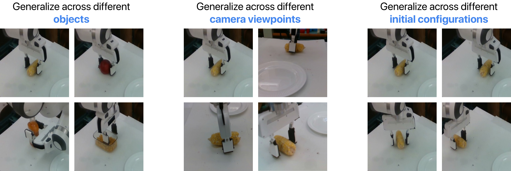
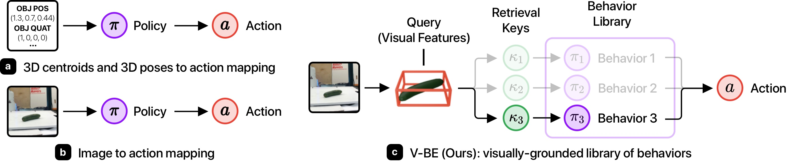
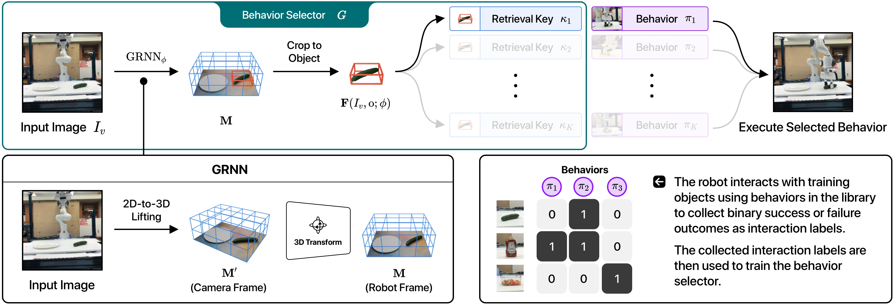
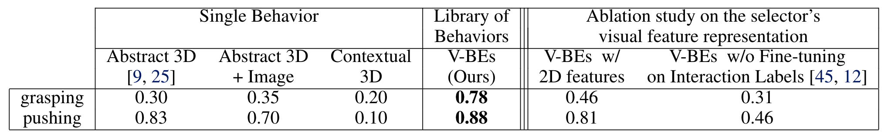
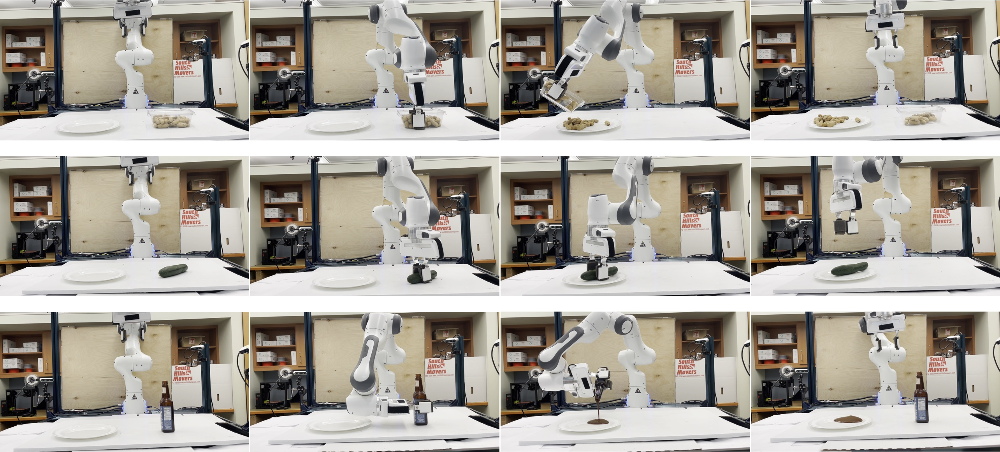

----

### Problem and Setup

We propose a novel policy representation that generalizes to unseen objects, object place-ments and camera views.

<div class="w1-row-padding">
    <div class="w1-col s12 w1-center">
        <div class="w1-row-padding">
            <div class="w1-col s12 w1-center" align="center">
                
            </div>
        </div>
    </div>
</div>

---

### Overview of Method

In contrast to state-to-action or image-to-action mapping, the proposed framework decomposes a policy into a behavior selection module and a library of behaviors to select from. The decomposition enables these modules to work on different representation: the selection module operates in a semantically-rich visual feature space, while the behaviors operates in an abstract object state space that facilitate efficient policy learning.

<div class="w1-row-padding">
    <div class="w1-col s12 w1-center">
        <div class="w1-row-padding">
            <div class="w1-col s12 w1-center" align="center">
                
            </div>
        </div>
    </div>
</div>

Given an input RGB-D image $I_v$ of the scene and an object 3D bounding box $\mathrm{o}$, the selector $\mathrm{G}$ predicts the probability of successfully manipulating the object when applying each behavior on the object. This is done by using geometry-aware recurrent neural networks (GRNNs) to convert the image to a 3D scene representation $\mathbf{M}'$, cropping the representation to the object using the provided 3D bounding box, and computing the cosine simularity between this object representation $\mathbf{F}(I_v, \mathrm{o}; \phi)$ and learned behavioral keys $\kappa_i$. for each behavior $\pi_i$ in the library. The behavior with the highest predicted success probability is then executed in the environment. We train the selector using interaction labels collected by running behaviors on random training objects and recording the binary success or failure outcomes of the executions.

<div class="w1-row-padding">
    <div class="w1-col s12 w1-center">
        <div class="w1-row-padding">
            <div class="w1-col s12 w1-center" align="center">
                
            </div>
        </div>
    </div>
</div>

----

### Quantitative Results

Our method out-performs various baselines and ablations in simulated pushing and grasping tasks.

<div class="w1-row-padding">
    <div class="w1-col s12 w1-center">
        <div class="w1-row-padding">
            <div class="w1-col s12 w1-center" align="center">
                
            </div>
        </div>
    </div>
</div>

We also perform real robot experiment in a setup where the robot needs to execute various skills to transport diverse rigid, granular, and liquid objects to a plate. Our framework achieves <b>88.6%</b> success rate in this task, while the <b><i>V-BEs with 2D beatures</i></b> baseline achieves only <b>38.0%</b> success rate and the <b><i>Image</i></b> baseline is not able to work at all in this task.

<div class="w1-row-padding">
    <div class="w1-col s12 w1-center">
        <div class="w1-row-padding">
            <div class="w1-col s12 w1-center" align="center">
                
            </div>
        </div>
    </div>
</div>

----

### Supplementary Video (Qualitative Results)

<div class="w1-row-padding">
    <div class="w1-col s12 w1-center">
        <div class="w1-row-padding">
            <div class="w1-col s12 w1-center" align="center">
                <iframe src="https://www.youtube.com/embed/1ldksubkYwQ" title="YouTube video player" frameborder="0" allow="accelerometer; autoplay; clipboard-write; encrypted-media; gyroscope; picture-in-picture" style="width: 50vw; height: 28.125vw" allowfullscreen></iframe>
            </div>
        </div>
    </div>
</div>

----

### Citations
```
@inproceedings{yang2021visually,
  title={Visually-Grounded Library of Behaviors for Manipulating Diverse Objects across Diverse Configurations and Views},
  author={Yang, Jingyun and Tung, Hsiao-Yu and Zhang, Yunchu and Pathak, Gaurav and Pokle, Ashwini and Atkeson, Christopher G and Fragkiadaki, Katerina},
  booktitle={5th Annual Conference on Robot Learning},
  year={2021}
}
```
