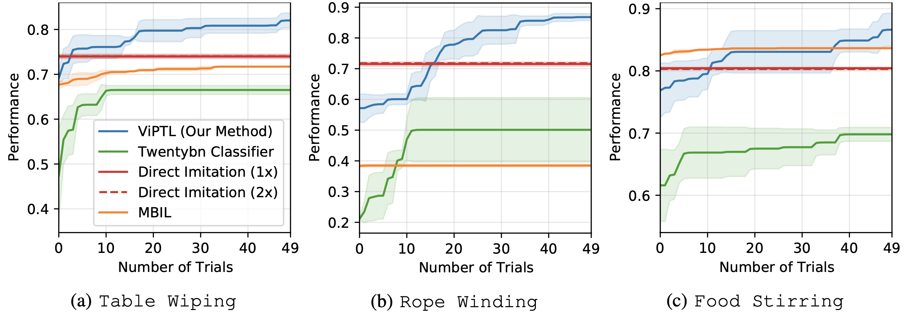
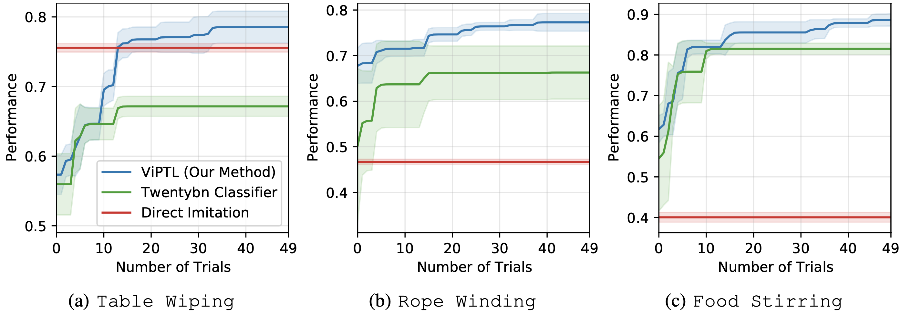

----

### Video

<div class="w1-row-padding">
    <div class="w1-col s12 w1-center">
        <div class="w1-row-padding">
            <div class="w1-col s12 w1-center">
                <video height="auto" width="100%" controls style="border: 1px solid #000;">
                    <source src="./video/viptl_3mins.mp4" type="video/mp4">
                </video>
            </div>
        </div>
    </div>
</div>

----

### Quantitative Results





----

### Citations
```
@inproceedings{
  yang2021viptl,
  title = {Learning Periodic Tasks from Human Demonstrations},
  author = {Yang, Jingyun and Zhang, Junwu and Settle, Connor and Rai, Akshara and Antonova, Rika and Bohg, Jeannette},
  year = {2021},
  url={https://yjy0625.github.io/projects/viptl},
}
```
